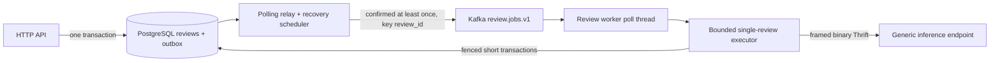

# Architecture and guarantees

## Ownership and dependencies

`app/domain.py` contains records; `app/inference/prompts.py`, `generation.py` and `review_output.py` contain pure review policy and validation. They do not depend on HTTP, Kafka or a database. `app/application/admission.py` owns validation/admission application policy; `execution.py` owns section orchestration. PostgreSQL is implemented in `app/persistence`; Thrift wire calls in `app/inference/rpc`; Kafka client construction and message validation in `app/messaging`. `app/api`, `app/relay` and `app/worker` are independent adapters/entrypoints. There is no API coordinator, model runtime, DynamoDB or SQLite path.

The generic Thrift protocol contains no review ID, section or business-specific fields. Business request/instance/section association is persisted in PostgreSQL before RPC. Review Kafka contracts and `review-v1` execution semantics are versioned here; changing prompts/execution incompatibly requires an execution-version migration strategy, not silently replaying old jobs under new semantics.

## Atomic admission

One PostgreSQL transaction locks the singleton admission row, looks up `(user_id, client_request_id)`, compares source/language, then enforces global active capacity, per-user active limit and shared database submission quota. Only then does it insert the review and reference-only outbox event. Same key/input returns the original review even if capacity is now full; changed input returns 409. Transaction commit completes before HTTP 202. The singleton lock deliberately favors simple correctness for the initial low-volume workload; it serializes admission across API replicas and can later be replaced by explicit capacity tokens if throughput demands it. Counts are never used without this lock.

Users, session-token hashes, CSRF tokens, signed cookies, review history, source/result, quotas, outbox, attempt, fence, leases, deadlines, section results and RPC identity live in PostgreSQL. Existing user isolation/password hashing/API shapes are retained; detail adds `execution_state` and `attempt` to expose recovery without redefining old status values. Source runtime data is not imported.

## Durable publication and execution

Relay claims due rows using `FOR UPDATE SKIP LOCKED` and an owner/expiry lease, releases DB locks before broker I/O, waits for Kafka delivery confirmation, then marks sent only while still owning its lease. A crash after confirmation may publish the same `event_id` twice. Kafka producer idempotence reduces broker retries but does not remove this crash window.

The worker disables both auto commit and automatic offset storage. Its poll thread runs continuously while one separate executor handles long inference. Assigned partitions are paused during processing; every record is processed in order and committed synchronously as that record's offset+1 only after a terminal result or transactional retry/recovery/DLQ handoff. A generation counter prevents commits after assignment ownership changes. Rebalance signals cancellation, leaves incomplete offsets uncommitted and relies on saved lease/intent recovery. Prefetched records are rewound instead of silently skipped. This intentionally limits each worker to one in-flight review.

A database slot row limits the initial deployment to **one inference instance and one actual review execution across all workers**. Worker count does not create GPU capacity. Atomic claim locks the slot and review, advances a monotonic fence and lease, and validates the intended attempt. All execution writes require the current fence and an unexpired DB lease. Late results from an old owner cannot overwrite a recovered execution. If another queued review occupies the consumer ahead of the slot owner's recovery event, it is durably delayed/re-enqueued without consuming an execution attempt so recovery cannot deadlock behind it.

Each section's instance ID, request ID, section and expected model identity are saved before start. Completed sections are persisted once and reused. Lost start responses cause get/cancel of the saved identity, never a repeated start. Expected model identity is checked on every result, including the first section. Database failures stop progress; they cannot authorize unsaved GPU execution. Whole-review execution deadline is fixed at first claim and survives restarts, alongside the admission-to-terminal task deadline.

## Recovery, limits and delivery semantics

Normal transient failures persist a future `available_at` and new outbox event in the same transaction, with exponential backoff capped by `RETRY_MAX_SECONDS` and bounded `MAX_RETRIES`. Relay polling is the durable delayed scheduler; no sleeping in-memory job is the sole owner of a retry. It also fences expired leases, republishes overdue unstarted jobs and expires queued tasks past their deadline.

RPC/socket timeout, lease expiration, cancel acknowledgement failure, unknown/expired result and service instance mismatch do **not** establish that GPU work stopped. Unresolved identity enters `recovery_required`, retains the slot, and reconciles the same request. Automatic reconciliation has capped exponential backoff and a bounded `MAX_RECOVERY_ATTEMPTS`; exhaustion enters `recovery_blocked`, keeps the saved identity/slot and emits a reference-only DLQ event. An operator can resume reconciliation after fixing connectivity. No timeout automatically clears the slot or starts a replacement generation.

This conservative design may block new execution after a service restart or expired retention when the old execution cannot be proved terminal. Availability is traded for bounded actual inference concurrency. A future multi-instance router must persist endpoint/instance ownership and capacity rather than load-balance start/get/cancel independently.

This is **at-least-once delivery with business idempotency**, not end-to-end exactly-once. PostgreSQL remains authoritative; Kafka is a recoverable delivery channel. Poison messages are quarantined by topic/partition/offset plus digest and sent to a DLQ through the same outbox, without storing the untrusted raw payload.

API readiness checks only its DB/schema. An inference outage does not prevent history queries. New tasks remain bounded by persisted backlog, per-user activity, quotas and task deadlines. API readiness does not imply Worker/GPU readiness. Worker/relay heartbeat probes observe their own loops; separate process logs and DB recovery state must be monitored. This extraction does not claim complete platform monitoring or production HA.
